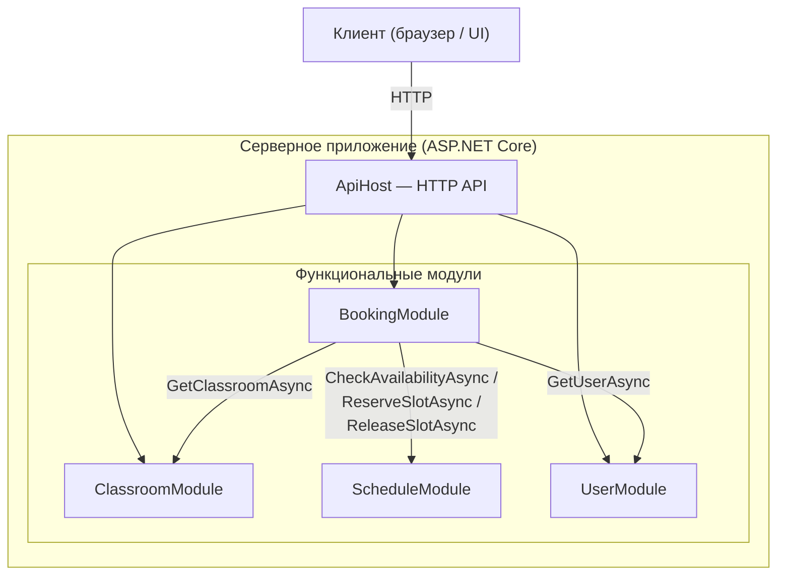

# Архитектурная схема

Для проекта выбрана модульная архитектура.

Центральным модулем бизнес-процесса является `BookingModule`.

При создании заявки он:

1. получает данные пользователя;
2. проверяет существование и состояние аудитории;
3. проверяет конфликт расписания;
4. создаёт заявку;
5. передаёт заявку администратору на принятие.