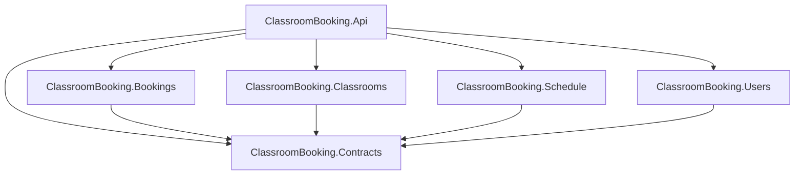

# Перечень зависимостей

## Внутренние зависимости



Бизнес-модули не обращаются напрямую к внутренним классам друг друга.  
Взаимодействие выполняется через публичные контракты.

Например:

```text
BookingModule → IScheduleConflictService → ScheduleModule
```

Это позволяет уменьшить связанность модулей.

## Внешние зависимости

| Зависимость | Назначение |
|-------------|------------|
| .NET 9 | Платформа выполнения |
| ASP.NET Core | Разработка серверного API |
| Entity Framework Core | Доступ к данным |
| SQLite | Хранение данных в учебной версии проекта |
| xUnit | Модульное и интеграционное тестирование |
| Git | Контроль версий |

Конкретные версии библиотек фиксируются в файлах проектов `.csproj`.